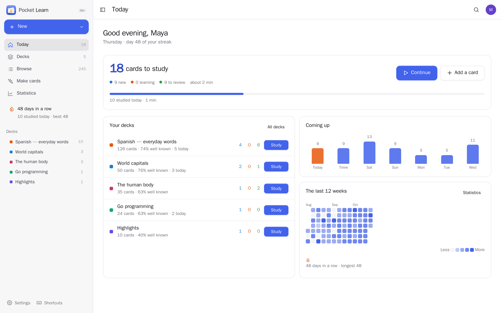
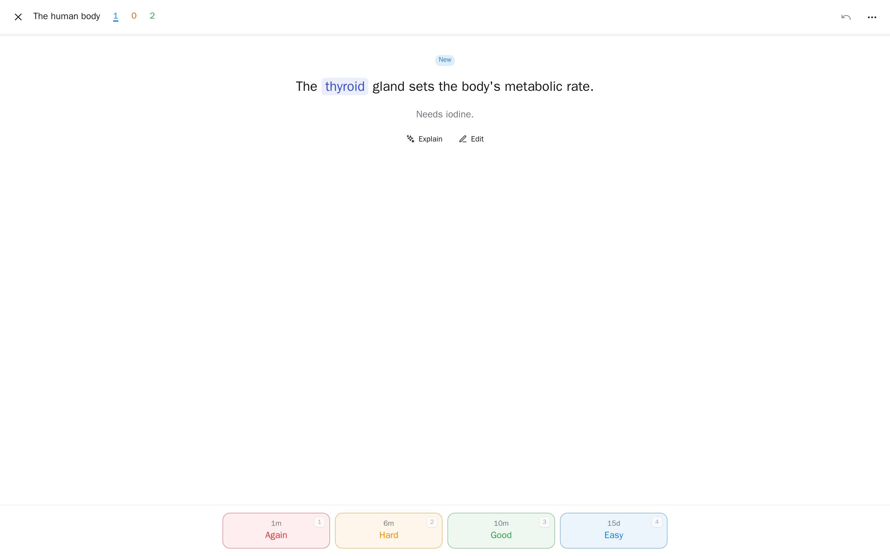
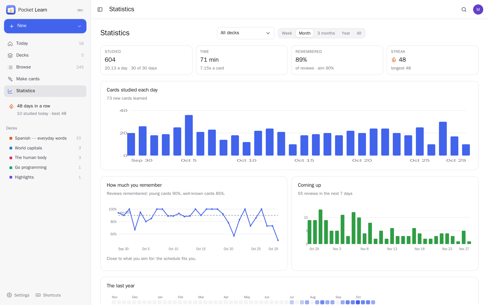
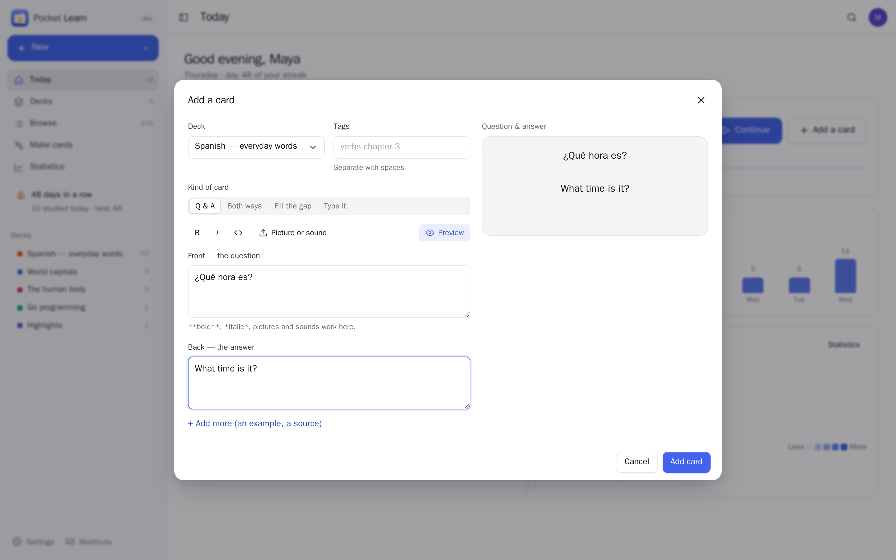
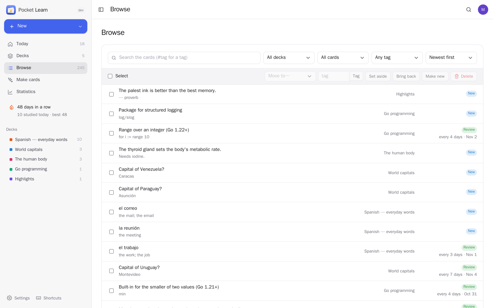
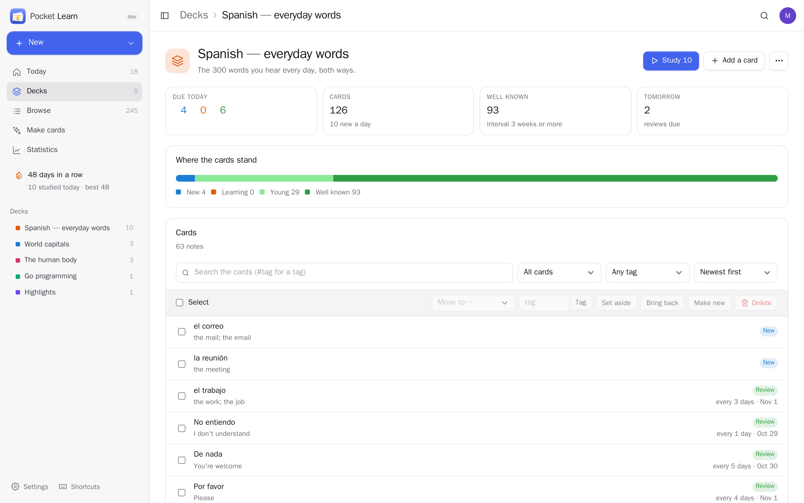
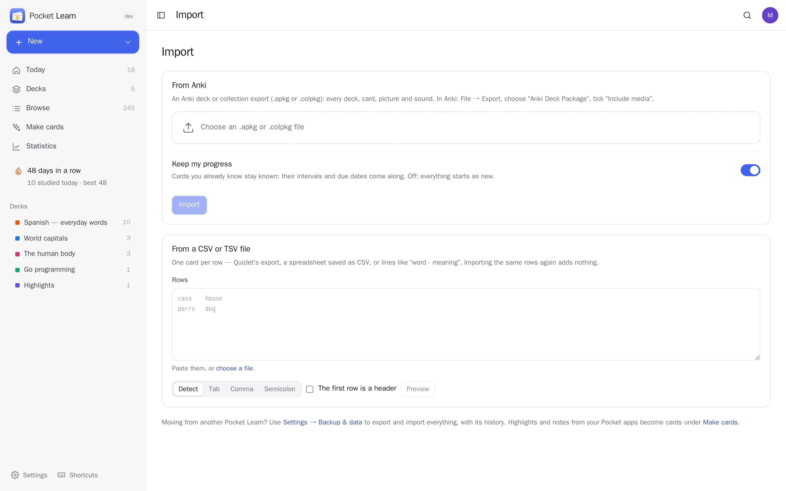
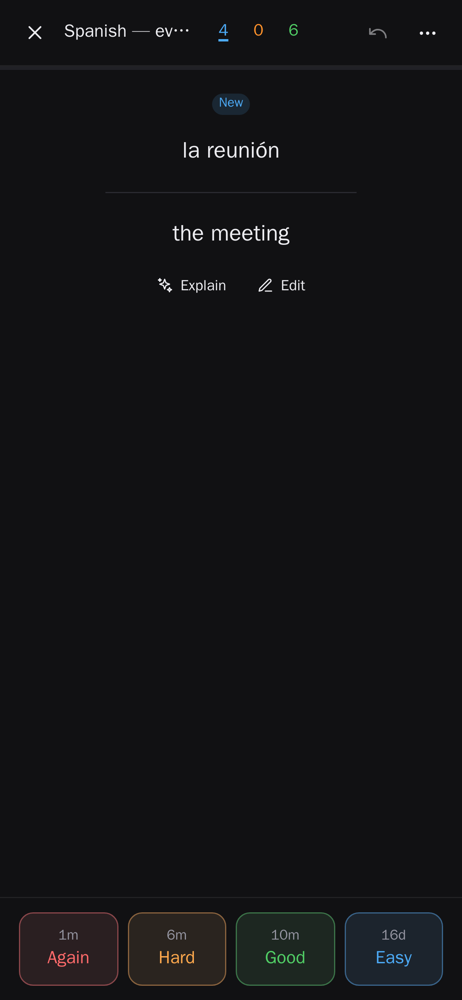
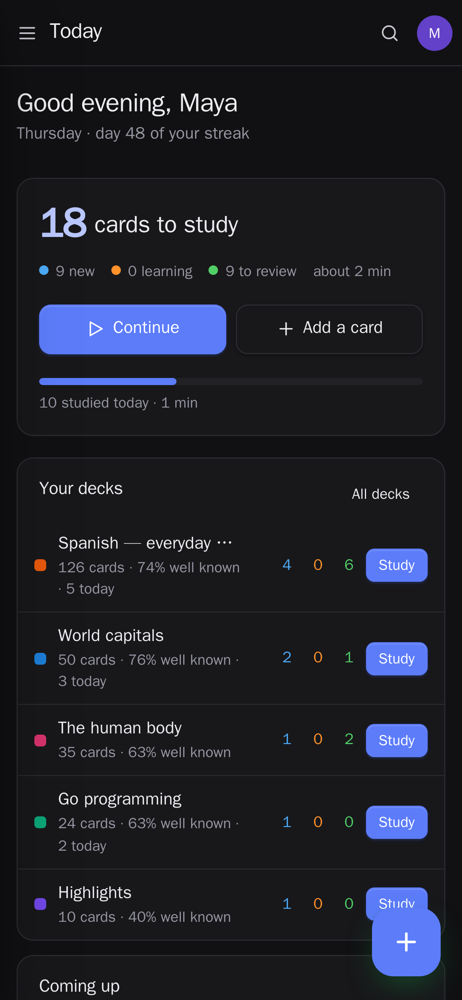

<p align="center"></p>
<h1 align="center">Pocket Learn</h1>
<p align="center">Learn anything, and keep it. Flashcards with spaced repetition on your own server: the FSRS scheduler (the one Anki uses today) shows each card just before you would forget it, so a few minutes a day are enough to remember things for years. Questions and answers, cards both ways, fill-the-gap and type-the-answer cards, pictures and sounds; bring your Anki decks along with their progress, import Quizlet or a spreadsheet, or let the AI write cards from a text, one of your notes or the passages you highlighted in Pocket Reader and Pocket Library. Streaks, a forecast, how much you really remember, and a study screen made for the keyboard and the phone.<br>One Go binary, one SQLite file, one volume. Part of the Pocket apps; works on its own too.</p>
<p align="center">
  <a href="https://github.com/abjelosevic88/pocket-homelab-learn/actions"></a>
  <a href="https://github.com/abjelosevic88/pocket-homelab-learn/pkgs/container/pocket-homelab-learn"></a>
  <a href="LICENSE"></a>
</p>

---

<p align="center"></p>

<table>
  <tr>
    <td width="50%"></td>
    <td width="50%"></td>
  </tr>
  <tr>
    <td align="center"><sub>Study: show the answer, then Again, Hard, Good or Easy — each button says when the card comes back.</sub></td>
    <td align="center"><sub>Statistics: cards a day, how much you really remember against what you aim for, the next 30 days.</sub></td>
  </tr>
  <tr>
    <td width="50%"></td>
    <td width="50%"></td>
  </tr>
  <tr>
    <td align="center"><sub>Add a card: four kinds, bold and italic, paste a picture or a sound, see it as you write.</sub></td>
    <td align="center"><sub>Browse every card: search, filter by deck, state or tag, move, tag, set aside or delete many at once.</sub></td>
  </tr>
  <tr>
    <td width="50%"></td>
    <td width="50%"></td>
  </tr>
  <tr>
    <td align="center"><sub>A deck: what is due, where the cards stand, its own daily limits and how sure to be.</sub></td>
    <td align="center"><sub>Import Anki packages with pictures, sounds and progress, or rows from Quizlet and spreadsheets.</sub></td>
  </tr>
</table>

<p align="center">
  &nbsp;&nbsp;
  
</p>

## What it does

- **Remember with FSRS**: every card has its own memory model (stability, difficulty); answering Again, Hard, Good or Easy moves it to just before you would forget it. Choose how sure you want to be (90% by default), the learning steps, daily limits per deck, when your day starts. Overdue cards are handled gracefully; nothing piles up into guilt.
- **Four kinds of card**: question and answer, both ways (a word and its meaning, two cards), fill the gap (`{{c1::Paris}} is the capital of France`, one card per gap, with hints) and type the answer (checked letter by letter).
- **Pictures and sounds**: paste or drop them into a card; sounds play by themselves if you like, and the question can be read aloud in the deck's language.
- **Study anywhere**: a calm, full-screen study screen with the keyboard (space, 1–4, z to undo, e to edit) or big buttons on the phone; bury a card until tomorrow, set it aside, flag it, ask the AI to explain it.
- **Bring your cards**: Anki `.apkg`/`.colpkg` (decks, cloze and reversed cards, tags, pictures, sounds, and your progress so known cards stay known), CSV/TSV from Quizlet or a spreadsheet with a column preview, and a full JSON export/import.
- **Cards made by AI**: paste a text, pick a note from Pocket Notes or highlights from Pocket Reader and Pocket Library, and the AI writes clear one-fact cards; you pick and fix the ones to keep. Pocket AI through Pocket Core, or your own OpenAI-compatible key.
- **Statistics**: cards per day, a year heatmap, true retention for young and well-known cards against what you aim for, the next 30 days, intervals, your best time of day, the cards you forget most.
- **Reminders**: a nudge when cards are due, an evening reminder before a streak ends, streak milestones and a weekly report through Apprise, ntfy or a webhook.
- **Everyone their own**: each person has their own decks, cards, settings and connections; admins see no one else's.

## Run it

```sh
docker run -d --name pocket-learn -p 8080:8080 -v ./data:/data \
  -e BASE_URL=https://learn.example.com -e SECURE_COOKIES=true \
  ghcr.io/abjelosevic88/pocket-homelab-learn:latest
```

or `docker compose up -d` with [docker-compose.yml](docker-compose.yml). Open it, create the first account and add your first card (or import a deck). All options: [docs/configuration.md](docs/configuration.md). API: [docs/api.md](docs/api.md). Backups: [docs/backup.md](docs/backup.md).

## With Pocket Core

Set `CORE_URL` and `CORE_REGISTRATION_KEY` and Learn joins the box: people sign in with Pocket Core, and through app links each person's own highlights (Pocket Reader, Pocket Library) and notes (Pocket Notes) can become cards with nothing to paste, written by Pocket AI. Other Pocket apps can read what you study (`learn:read`: decks, cards due, each day's studying and the streak — never the cards; Pocket Day's journal, dashboards) or add cards (`learn:write`: only changing what they added). Events on the bus: `learn.session_finished`, `learn.all_done`, `learn.cards_added`, `learn.streak_reached`. Without Core every connection can be made directly with a URL and a token; the Core-only choices stay visible, greyed out.

## Develop

```sh
make dev     # API on :8080 with demo data + Vite on :5173
make test    # go vet, go test, tsc
make         # web + binary
```

MIT licensed. The scheduler follows FSRS-5 by the [open-spaced-repetition](https://github.com/open-spaced-repetition) project; Anki is a trademark of its owners and this app is not affiliated with it.
